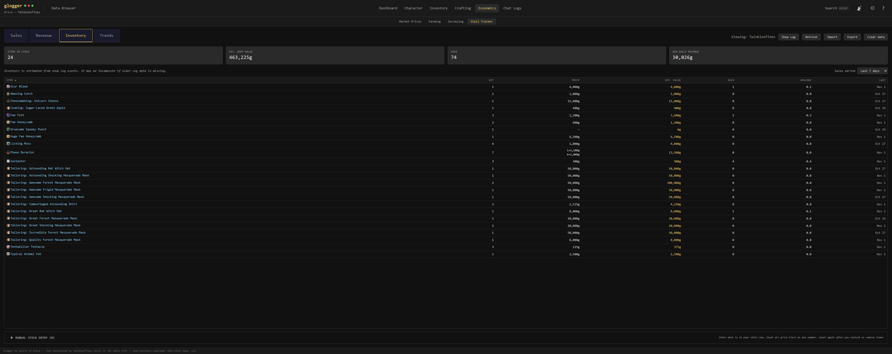

# Economics — Stall Tracker

## Overview

Player-stall analytics built from the in-game **PlayerShopLog** book. Every time
the user opens their shop log in-game, Glogger captures the book content via the
Player.log `ProcessBook` event, parses each log line into a structured event,
and persists it to SQLite. The Stall Tracker screen then presents that history
as sales, revenue, and estimated current inventory.

The feature is **fully scoped to the active character**. A single account may
run multiple alts, each with their own stall; every query, aggregation, import,
export, and filter dropdown filters on `owner = <active character>` so
characters don't cross-contaminate.

Shop log data also supports **Import** (load an exported book file) and
**Export** (write one book-format file per date) so users can backfill historic
data from CSVs or back up a character before the in-game log scrolls old
entries out of range.

The Stall Tracker has four visible tabs plus a fifth view behind a modal:

| View | Purpose |
|---|---|
| Sales | Paginated list of every `bought` event with filters, sorting, stats header, per-row ignore toggle |
| Revenue | Excel-style pivot of revenue with items as rows and daily/weekly/monthly periods as columns |
| Inventory | Estimated current shop stock reconstructed from the event log with per-tier pricing |
| Trends | Sales-over-time chart (gold/units lines, top-grossing or single-item modes) |
| Shop Log (modal) | Full event log across all action types — a maintenance view for finding/ignoring specific events |

## Visible surfaces

### Sales tab


*The default landing surface. Stats header recomputes from the filtered set, not just the loaded page. Sortable on every column. The `⊘` / `○` toggle in the first column mutes a row from aggregations (still visible greyed-out in the list).*

### Revenue tab


*Pivot with items × periods. Daily / Weekly / Monthly granularity toggle. Periods display newest-first so today is the leftmost column after the sticky Total. Items column and Total column are both sticky-left (frozen-corner pattern).*

### Inventory tab



*Reconstructed from the event log via per-item tier-stack replay. Multi-tier price column shows `qty × price` rows when an item is listed at multiple tiers. One gold reset row ("Fix stock from fresh log…") is the whole drifted-counts flow: a how-to dialog states the in-game prerequisite (empty the stall, add everything back, save the book), then a file picker takes the fresh book, a preview confirm shows the set/zero split with names (sales history untouched), and apply stamps one baseline per line in a single transaction. Each In Stock row keeps a per-row Clear (✕) for single-item fixes; an Advanced section (collapsed) holds Undo-recount plus Manual stock entry for hand counts.*

### Shop Log modal


*Maintenance view, lazy-mounted on first open. Shows all eight action buckets including the unparseable `unknown` bucket. Each action gets a distinct color tint (green=bought, blue=added, red=removed, amber=configured, cyan=visible, gold=collected, purple=hired). Sortable on every column. The modal persists its filter/sort/scroll state across close/reopen within the session.*

## Architecture

### Files

**Backend (Rust):**

- `src-tauri/src/shop_log_parser.rs` — regex parser: splits book content into entries, extracts fields per action type, assigns stable indices, detects owner.
- `src-tauri/src/stall_year_resolver.rs` — resolves the game's year-less `"Mon Apr 13 14:29"` timestamps into ISO 8601 by walking forward through the entries and handling year-boundary crossings.
- `src-tauri/src/stall_aggregations.rs` — pure aggregation logic for Revenue pivot and Inventory tier-stack reconstruction. No DB access.
- `src-tauri/src/db/stall_tracker_commands.rs` — Tauri commands, filter shape, insert helper, import/export.
- `src-tauri/src/db/migrations.rs` — `stall_events` table creation.
- `src-tauri/src/coordinator.rs` — intercepts `PlayerEvent::BookOpened { book_type: "PlayerShopLog", … }` and persists the parsed events.

**Frontend (Vue/TS):**

- `src/types/stallTracker.ts` — TypeScript mirrors of the Rust payloads (`StallEvent`, `StallStats`, revenue/inventory/timeseries shapes, manual count rows, import/export results).
- `src/stores/stallTrackerStore.ts` — shared state (`stats`, `filterOptions`, `dataVersion`, `currentOwner`), listens for coordinator events.
- `src/components/StallTracker/StallTrackerView.vue` — parent view with `TabBar`, action-row buttons, Shop Log modal.
- `src/components/StallTracker/StallSalesTab.vue` — paginated sales table + stats header.
- `src/components/StallTracker/StallRevenueTab.vue` — pivot table (Daily / Weekly / Monthly).
- `src/components/StallTracker/StallInventoryTab.vue` — In Stock table with tier-stack pricing, fresh-log recount flow, and the manual stock entry editor.
- `src/components/StallTracker/StallTrendsTab.vue` — sales-over-time chart (Gold/Units toggle, top-grossing and single-item modes).
- `src/components/StallTracker/StallShopLogTab.vue` — full event log (rendered inside a teleported modal).

The Sales / Revenue / Shop Log filter rows depend on two shared components: `src/components/Shared/SearchableSelect.vue` for the buyer / item / action dropdowns, and `src/components/Shared/DatePicker.vue` for the from / to date inputs. Both are documented in [shared-components.md](../../../architecture/shared-components.md).

Item names are rendered via `<ItemInline>` in the item-display surfaces (Sales row, Inventory In Stock row, Shop Log row, Revenue pivot row label) so hovering an item shows its CDN tooltip with rarity / equip slot / stats, and clicking navigates to the Data Browser.

## Event Pipeline

```text
Game writes <game_data>/Books/PlayerShopLog_*.txt per opened shop log
    │
    ├─► live path (Player.log ProcessBook → coordinator ingest_shop_log)
    │       — dark since the 10/21 client stopped emitting LocalPlayer: lines
    │
    └─► Books watcher (30s scan, mtime-tracked) ──► process_book_file
                                                        │
                                                        ▼
                            shop_log_parser::parse_shop_log()
                                                        │
                                                        ▼
                            stall_tracker_commands::insert_stall_events()
                                                        │
                         ┌──────────────────────┴──────────────────────┐
                         ▼                                             ▼
                    stall_events table                app.emit("stall-events-updated", N)
                                                                       │
                                                                       ▼
                                                stallTrackerStore (debounced refresh)
                                                                       │
                                                                       ▼
                                                   dataVersion++ → tabs re-fetch
```

The Books-directory watcher is the live source today; the Player.log
`ProcessBook` path is wired but dark (no `LocalPlayer:` lines since the
10/21 client update). **Chat.log is not involved** — unlike Surveying,
stall events never need cross-log correction. A manual Refresh command
(`rescan_stall_books`) re-runs the same ingest statelessly
(fullest-witness dedup) for users who just opened their log in-game.

A `PlayerShopLog` book's content is a `\n\n`-separated list of entries, each
prefixed with a `Day Mon DD HH:MM -` timestamp. Seven action types are
recognized; an eighth bucket (`unknown`) captures anything that doesn't match so
nothing is silently dropped.

| Action | Example line | Fields parsed |
|---|---|---|
| `bought` | `MrBonq bought Quality Reins at a cost of 4500 per 1 = 4500` | player (buyer), item, quantity, price_unit, price_total |
| `bought` (stacked) | `MARCELA bought Aquamarine x5 at a cost of 750 per 1 = 3750` | item="Aquamarine", quantity=5 (xN extracted from item) |
| `added` | `Deradon added Barley Seeds x36 to shop` | player (owner), item, quantity |
| `removed` | `Deradon removed Decent Horseshoes from shop` | player (owner), item, quantity |
| `configured` | `Deradon configured Barley Seedsx36 to cost 3000 per 2.` | player (owner), item, quantity, price_unit |
| `visible` | `Deradon made Nice Saddle visible in shop at a cost of 4000 per 1` | player (owner), item, quantity, price_unit |
| `collected` | `Deradon collected 30500 Councils from customer purchases` | player (owner), price_total |
| `hired` | `Deradon paid 5000 Councils to hire a stall for 24 hours` | player (owner), price_total (hire fee) |

### Entry Index Stability

Shop log content arrives **newest-first** from the game. If we indexed entries
in content order, the newest entry would be `0`, and when the user re-opened
the same book with new entries prepended, every existing entry would shift to a
higher index.

The parser reverses the raw entries before indexing so the **oldest entry always
gets index `0`**. New entries appended at the top later receive higher indices,
keeping existing entries' indices stable across re-opens of the same book.
`entry_index` is still stored per row (sort tiebreaker, export ordering), but
it is NOT part of the ingest identity: the same line parses to a different
index in books of different lengths, so keying on it re-inserts every
overlapping line. Ingest de-duplicates by fullest-witness rule per logical
line (`event_timestamp`, `raw_message`): the fullest batch (most occurrences;
ties go to the newest) is the witness and its rows stay, other batches' rows
for that line go; a partial re-ingest carrying fewer copies inserts and
deletes nothing. The storage UNIQUE key stays
`(event_timestamp, raw_message, entry_index)` (v23, unchanged) — ingest dedup
is enforced by the witness logic, not by the key. v89 collapsed the pre-fix
duplicates the same way (inventory-ledger actions only; identical same-minute
sales are retained — ambiguous multiplicity must never delete revenue).

### Year Resolution

The game's in-game book format omits the year — `Mon Apr 13 14:29`. The Stall
Tracker needs a real ISO timestamp (`event_at`) for date-range filtering, for
revenue pivot grouping, and for the export round-trip. Resolution strategy:

- **Live tailing** — `base_year_for_live()` starts from `now.year()` and walks
  back one year if the oldest entry's `(month, day)` is in the future relative
  to now, meaning the book contains entries from the previous calendar year.
- **Import** — `year_from_filename()` extracts a 4-digit year between 2000 and
  2099 from the filename (e.g., `Deradon-shop-log-2026-04-13.txt`), falling
  back to `Local::now().year()` if no match.
- **Backfill** — infers year from `created_at`. Events can never be in the
  future at insert time, so if the parsed `(month, day)` is later than
  `created_at`'s month/day, the event is from the previous year. Used when a
  schema change adds `event_at` to rows that pre-date the column.

`resolve_timestamps_oldest_first()` then walks the entries forward. Any
backward month jump (e.g., Dec → Jan) increments the year, so books that span a
year boundary resolve correctly.

### Owner Assignment

Every row is stamped with an `owner` at insert time so reads can scope by
character. The source of that owner depends on the ingest path:

- **Live tailing** — the owner is **always the active character** from
  `settingsStore.activeCharacterName`. The game only lets a player open their
  own `PlayerShopLog` book, so the active character is the book owner by
  definition. The coordinator does not parse the owner out of the book body.
- **Import** — the parser advisory-detects an owner by scanning for the first
  **owner action** (`added`, `removed`, `configured`, `visible`, `collected`, `hired`)
  — actions only a stall owner can perform (a hire-only book still identifies its owner). This hint lets the import
  command distinguish three cases:
  1. **Book owner matches active character** — normal import, stamp with the
     parsed owner.
  2. **Book owner is a different character** — e.g., a file sent by a
     guildmate, or an alt's export. Stamp with the parsed owner and return
     it in `ImportResult.effective_owner` so the UI can surface
     *"Imported 134 for Alvida. Switch character to view them."*
  3. **Book has no owner actions at all** — bought-only historical files
     (CSV-derived books, old exports). Fall back to the caller-supplied
     `current_owner` and set `ImportResult.owner_claimed = true`. The UI
     surfaces *"claimed for Deradon — book(s) did not identify an owner."*

The parser exposes the owner hint as `ShopLog.owner: Option<String>`. It is
**advisory only** — the coordinator ignores it in the live path, and the
import command treats it as "owner if known, else fall back." Do not treat
`ShopLog.owner` as a source of truth anywhere else.

## Database Schema

### `stall_events`

| Column | Type | Notes |
|---|---|---|
| id | INTEGER PK | auto-increment |
| event_timestamp | TEXT | Raw game format `"Mon Apr 13 14:29"`. Preserved for round-trip export. |
| event_at | TEXT | Real ISO 8601 `"YYYY-MM-DD HH:MM:SS"`. All time-range queries use this column. |
| log_timestamp | TEXT | Timestamp when the book was opened. `"imported"` / `"seeded"` for synthetic rows. |
| action | TEXT | One of the seven action types plus `"unknown"`. |
| player | TEXT | Buyer for `bought`, owner for everything else. |
| owner | TEXT | The character that owns this row's data. Every read/mutation scopes on this. |
| item | TEXT | Nullable (`collected`/`hired` have no item). |
| quantity | INTEGER | Defaults to 1. |
| price_unit | REAL | Price per unit (possibly fractional for `per N > 1` entries). |
| price_total | INTEGER | Total price for `bought` and `collected`; hire fee for `hired`. |
| raw_message | TEXT | Exact in-game phrasing, used for export round-trip. |
| entry_index | INTEGER | Position within the book (oldest = 0). Stable across re-opens of the same book; not part of the ingest identity (same line shifts index across books). |
| ignored | INTEGER | 0/1 soft-mute flag. Excluded from all aggregations. |
| created_at | TIMESTAMP | SQLite `CURRENT_TIMESTAMP` at insert time. |

**Unique constraint:** `(event_timestamp, raw_message, entry_index)` (storage
level, v23, unchanged; `entry_index` keeps same-minute repeats distinct).
Ingest identity is the fullest-witness rule per logical line
(`event_timestamp`, `raw_message`): the fullest batch wins (ties newest), a
partial re-ingest inserts/deletes nothing.

**Indices:** `action`, `created_at DESC`, `event_timestamp`, `event_at DESC`,
`(action, event_at DESC)`, `player`, `item`.

## Tauri Commands

| Command | Purpose |
|---|---|
| `get_stall_events(params)` | Paginated list of events with filters, sort, limit/offset. Returns `{ rows, total_count }`. Empty when `owner` missing. |
| `get_stall_stats(filters)` | Aggregate stats (total sales, revenue, unique buyers/items) for the Sales header. Always scoped to `bought` + non-ignored. |
| `get_stall_revenue(params)` | Daily/weekly/monthly pivot. Returns pre-computed `periods`, `items`, `cells`, row/col totals, grand total. |
| `get_stall_inventory(params)` | Inventory tier-stack report with per-item quantity, price tiers, period sales, and last sold. Seeds from `stall_inventory_baseline` rows. |
| `rescan_stall_books()` | Stateless sweep of `Books/PlayerShopLog_*.txt` for the active character. Returns `(files_scanned, new_events)`. |
| `save_stall_baseline(input)` | Upsert one manual count row (qty 0 stores a zeroed count that clears the item). Re-stamps `recorded_at` to now. |
| `get_stall_baselines(owner)` | List manual count rows for the active character. |
| `delete_stall_baseline(id, owner)` | Delete one manual count row by id, owner-scoped. |
| `delete_all_stall_baselines(owner)` | Delete every manual count for a character without touching shop-log events. Inventory reverts to pure log estimates. |
| `get_stall_filter_options(owner)` | Distinct buyers, players, items, dates, actions for filter dropdowns. |
| `toggle_stall_event_ignored(id, ignored, owner)` | Mute/unmute one event row from aggregations (owner-scoped). |
| `preview_stall_recount(path, current_owner)` | Pure-read recount preview: replay a fresh book into per-item counts, diff against in-stock. |
| `apply_stall_recount(path, current_owner)` | Stamp the preview as baselines (counted qty + book price, zeroes for unlisted) in one transaction. Events untouched. |
| `clear_stall_events(owner)` | Delete every row for a specific character. Requires `owner`. Serialized with live ingest by the single-write pool + `BEGIN IMMEDIATE`. |
| `import_shop_log_file(path, current_owner)` | Read a `.txt` file, parse, insert. Returns counts + effective owner + `owner_claimed` flag. |
| `export_shop_log_files(directory, owner)` | Write one file per (owner, date) in exact book format for round-trip. Requires `owner`. |
| `seed_stall_events_dev(count, owner)` | Dev-only bulk insert for benchmarking at 10k/100k scale. |

### Filter shape

```rust
pub struct StallEventsFilters {
    pub owner: Option<String>,       // ALWAYS passed by the frontend
    pub action: Option<String>,      // force-override available via force_action param
    pub player: Option<String>,
    pub item: Option<String>,
    pub date_from: Option<String>,   // "YYYY-MM-DD"
    pub date_to: Option<String>,     // "YYYY-MM-DD"
    pub include_ignored: Option<bool>,
}
```

The backend `build_filter_where()` helper turns this into a WHERE clause + bound
parameter list. Queries with a missing/empty `owner` return empty results
instead of leaking cross-character data.

## Operations

The action row in the parent view exposes five buttons: Shop Log (gated on
`hasData`), Refresh (always available; re-runs the Books sweep
statelessly, with a Synced relative-time label stamped on success), Import
(always available so a fresh character can bootstrap from an exported book),
and Export + Clear data (gated on `hasData && currentOwner`).

### Fix stock from fresh log (recount)

The one-click reset for drifted counts. The book is a sliding window, so a
plain save only covers recent lines — the in-game prerequisite is empty the
stall, add everything back, save the book, and the how-to dialog states
exactly that before the file picker opens. Preview replays the fresh book
and the confirm shows the set/zero split with names. Apply stamps one
baseline per line in a single transaction without touching event rows, so
Revenue / Trends / Sales never move. Advanced (collapsed) holds the undo
plus Manual stock entry for hand counts.

### Import


*Multi-file `.txt` picker. Each file is parsed and persisted in its own
transaction, so a single malformed file in a 5-file batch doesn't lose the
other 4. The summary message tallies entries per owner (with a `(claimed)`
marker on owner-less books that fell back to the active character) and
explicitly names any failed files.*

### Export


*Directory picker. Writes one file per `(owner, date)` in the exact in-game
book format so any exported file is re-importable without duplicating rows
(fullest-witness rule: fullest batch wins, partial re-ingest no-ops).*

### History window

*History dropdown beside Sales period (30 / 60 / 100 / year / all; default
100 days). The stock replay only looks back that far: in-game takedowns log
no `removed` line, so ancient `added` lines replay as phantom stock forever
without a bound (live 2026-11 case: full history 110 rows for a 41-slot
stall, 100-day window 47). Reversible one click (All history).
Frontend-owned view state, not stored.*

### Clear data


*Native warning dialog that names the active character explicitly and
recommends Export first, since in-game shop log books only hold recent
history. Serialized with live ingest by the single-write pool +
`BEGIN IMMEDIATE`, so a concurrent batch can't write after the clear.*

## Frontend Events

| Event | Payload | Purpose |
|---|---|---|
| `stall-events-updated` | `usize` (new row count) | Emitted by the coordinator after every successful live-ingest batch. The store debounces 500ms and bumps `dataVersion`. |

## Concurrency & Race Protection

Clear-vs-insert serialization comes from the single-write pool plus
`BEGIN IMMEDIATE` transactions (`src-tauri/src/db/mod.rs` owns the
pool-is-the-lock invariant): Clear is two `DELETE`s (events + baselines) in
one `BEGIN IMMEDIATE` transaction, live ingest is one transaction per batch,
so SQLite serializes the two atomically. No app-level lock — a second mutex
would only add deadlock shape for zero extra safety.

## Character Scoping

Every query, aggregation, mutation, import, export, and filter-option lookup
is scoped to `owner = <active character>`. This is enforced at three layers:

1. **Backend guard** — read commands return empty results when `owner` is
   missing/empty. Mutation commands (`clear`, `export`, `seed`) return a
   `"requires an owner"` error.
2. **Frontend contract** — the store exposes `currentOwner` as a reactive
   computed over `settingsStore.settings.activeCharacterName`. Every tab
   threads it through `buildParams()` / `reload()`. Empty strings are
   normalized to `null`.
3. **UI gating** — Clear and Export buttons are hidden unless
   `hasData && store.currentOwner`. Belt-and-suspenders.

When the active character changes, `stallTrackerStore` watches `currentOwner`
and bumps `dataVersion`, which triggers every tab's `watch(() => store.dataVersion)`
to refetch. Each tab also watches `currentOwner` directly to reset its local
filter state, so a buyer name from character A doesn't silently carry over to
character B.

## Time Handling

Stall Tracker follows the app-wide time standards defined in
[time.md](../../../architecture/time.md).

- **`event_timestamp`** stores the raw game format (`"Mon Apr 13 14:29"`) and
  is only used by Export to reconstruct the book body verbatim.
- **`event_at`** is the real ISO 8601 datetime derived by `stall_year_resolver`.
  All date-range filters, Revenue pivot grouping, and Inventory window logic
  use this column.
- **Display format** — the Sales and Shop Log tabs display the raw
  `event_timestamp` (the game's own format) since users are already trained on
  it and no conversion adds clarity. The Inventory tab's `LAST` column slices
  the first 10 chars of `last_activity_at` and renders it as `"Apr 13"`.
  `last_sold_at` is computed per item but has no dedicated column.
- **Revenue year suffix** — when `aggregate_revenue` detects that the dataset
  spans multiple calendar years, daily and weekly period labels get a year
  suffix (`"Apr 13 2026"`) so same-label collisions can't happen. Single-year
  datasets keep the concise no-year format. Detection is a single-pass HashSet
  over `event_at` dates.

## Known Issues & Improvement Plans

### Inventory accuracy

Reconstruction is only as accurate as the shop log history. The primary fix
is the recount above (remove-all + re-add forces the whole stall into one
fresh book; baselines suppress everything older). Older mechanisms that
narrow the gap without a live `LocalPlayer:` feed:

- **Fallback pricing** — stock added but never made visible/configured (or
  whose pricing history scrolled out) has no priced tier. When NO priced tier
  survives, the aggregator values it at the item's `last_known_price` (from
  later `visible`/`configured`/`bought` events) instead of 0, and counts the
  units in `fallback_priced_qty` (shown as `~` beside the price).
- **Truncation flags** — each item records its earliest event. When that
  event is not a baseline (`added`/`visible`/`configured`), the row carries
  `history_truncated: true` (⚠ in the table, per-row oldest-event tooltip)
  and the header names the oldest event across truncated items.
- **Manual stock entry** — `stall_inventory_baseline` (one row per
  owner+item: counted qty + current price). `get_stall_inventory` seeds the
  tier replay from it and drops shop-log events at-or-before its timestamp
  for that item. Set it by counting stock in-game (Inventory tab → Manual
  stock entry); qty 0 stores a zeroed count that clears the item. Re-counting re-stamps `recorded_at` to now. The count is only as true as the last count: a delist after counting without a logged removed line stays invisible until the next count or a logged removal. Recount the whole item after restocking or delisting (one count per item, not per tier).
- **Per-row Clear** — each In Stock row has a ✕ that zeroes just that item
  behind a confirm (single-item fix).
- **Undo recount** — the Advanced section deletes every manual count WITHOUT
  touching shop-log events (the recount undo when the wrong book was picked).
- The parser treats entries that don't match any action regex as `"unknown"`.
  These are hidden from the default Shop Log view and excluded from every
  aggregation, but remain available via the action filter (select `unknown`
  to surface them). Stall hire payments parse as `hired` (owner, hire fee in
  `price_total`) — they surface in the Shop Log list so "rented, zero sales"
  is distinguishable from "never rented", but stay out of every
  sales/inventory aggregation.
